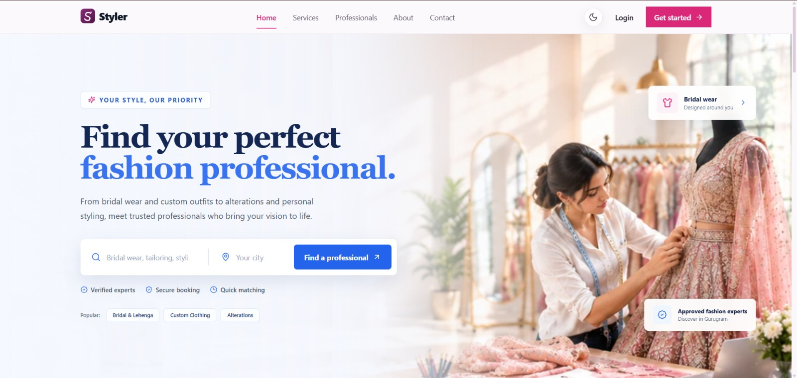
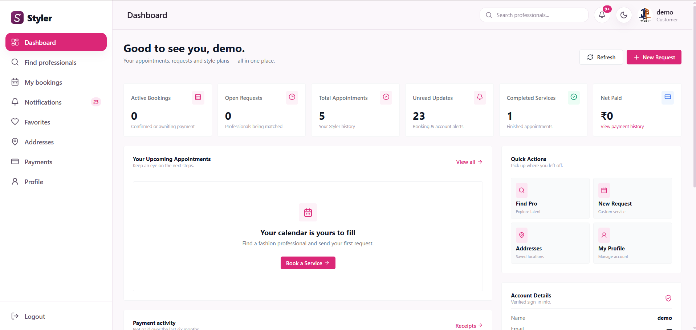
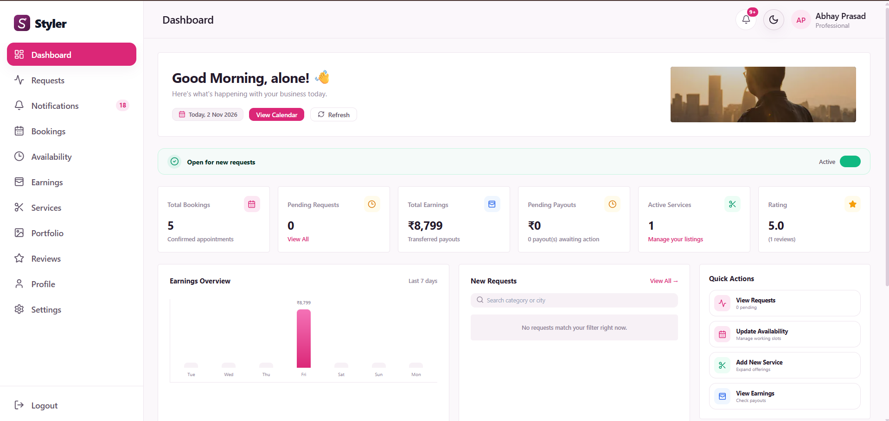
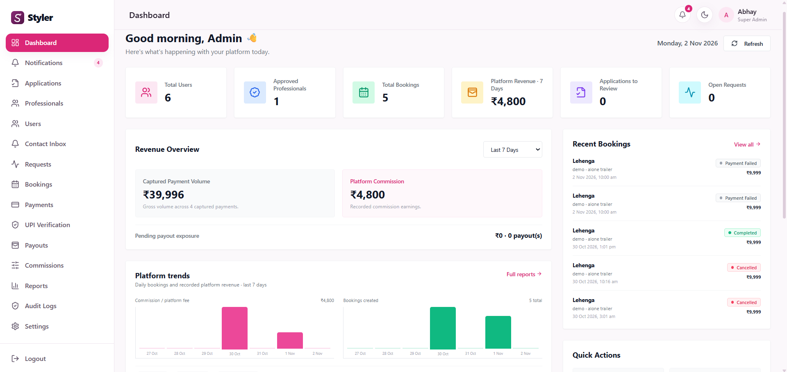
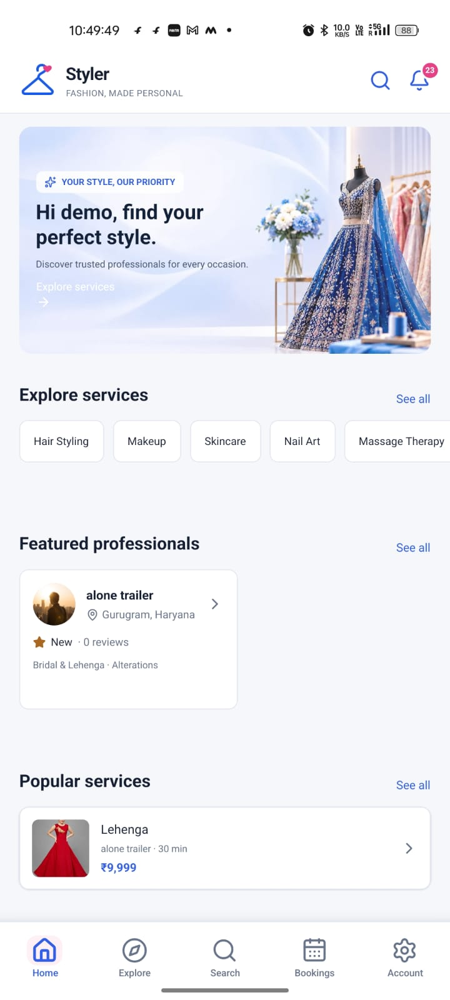
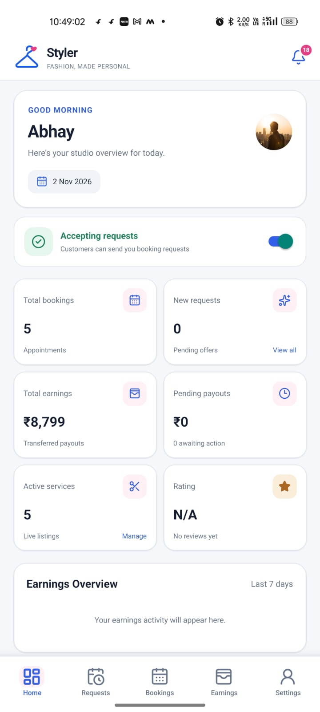
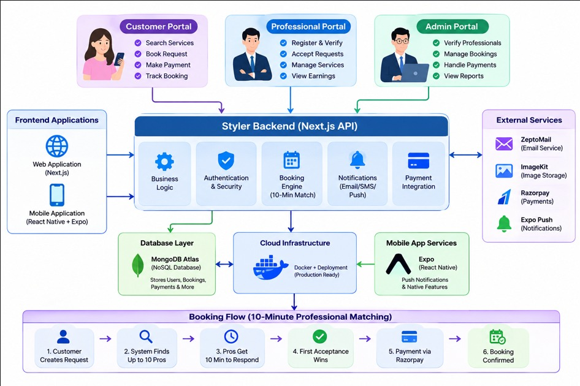

<div align="center">

# ✨ Styler

### A 10-Minute Fashion Professional Matching and Booking Platform

**Discover. Connect. Book. Experience.**

A multi-platform fashion and beauty services marketplace that connects customers with verified professionals through an intelligent service-matching and booking experience.

[](https://nextjs.org/)
[](https://expo.dev/)
[](https://reactnative.dev/)
[](https://www.typescriptlang.org/)
[](https://www.mongodb.com/)

</div>

---

## 📖 Table of Contents

- [About Styler](#-about-styler)
- [The Platform](#-the-platform)
- [Core Features](#-core-features)
- [User Roles](#-user-roles)
- [How Styler Works](#-how-styler-works)
- [Screenshots](#-screenshots)
  - [Web Application](#-web-application)
  - [Mobile Application](#-mobile-application)
- [Technology Stack](#-technology-stack)
- [System Architecture](#-system-architecture)
- [Project Structure](#-project-structure)

For setup, configuration, testing, deployment, and other technical documentation, see the second half of this README.

---

## 💡 About Styler

**Styler** is a fashion and beauty services marketplace designed to make finding and booking professional services simple, convenient, and accessible.

The platform connects customers who need fashion or beauty services with professionals who offer them.

Its central concept is a **10-minute professional matching and booking workflow**, where service requests can be matched with eligible professionals and offers can be dispatched within a configurable time window of up to 10 minutes.

Styler brings customers, professionals, and administrators together in one connected ecosystem.

The product consists of three integrated components:

- **Web Platform:** A Next.js application for customers, professionals, and administrators.
- **Mobile Application:** An Expo and React Native application for mobile users.
- **Shared API:** A centralized Next.js API that manages authentication, business logic, bookings, payments, and data operations.

Both web and mobile clients communicate with the same server-side API. The mobile application does not access MongoDB directly.

### 🎯 Our Goal

To simplify the fashion and beauty service-booking experience by connecting customers with suitable professionals through a convenient, organized, and reliable marketplace.

---

## 🌐 The Platform

Styler is built around three main experiences.

| Platform | Description |
|---|---|
| 🌐 Web Application | A complete marketplace experience with customer, professional, and admin portals. |
| 📱 Mobile Application | A mobile-first experience built with Expo and React Native. |
| ⚙️ Shared Backend | A centralized API responsible for authentication, business logic, data, and integrations. |

### Platform Highlights

- One marketplace for customers and fashion professionals.
- A dedicated experience for each user role.
- Professional discovery and service browsing.
- A structured booking and offer-management workflow.
- Integrated payment and payout management.
- Real-time-style booking communication through in-app conversations and notifications.
- Centralized administration and marketplace management.

---

## 🚀 Core Features

Styler provides features for the complete marketplace lifecycle.

### 🔍 Professional Discovery

- Browse approved professional profiles.
- Explore available fashion and beauty services.
- View professional portfolios and reviews.
- Discover professionals based on available service information.

### 👤 Account and Authentication

- Customer and professional registration.
- Email verification.
- Secure login and session management.
- Password recovery.
- Role-based access and protected portals.

### 💼 Professional Management

- Professional onboarding and applications.
- Profile and portfolio management.
- Service creation and management.
- Availability management.
- Booking offer responses.
- Booking and payout information.

### 📅 Booking and Matching

- Customer booking requests.
- Service and schedule selection.
- Saved service addresses.
- Matching with eligible professionals.
- Professional offer dispatch.
- Offer acceptance and quote handling where applicable.
- Booking status management.
- Configurable offer window of up to 10 minutes.

### 💳 Payments and Payouts

- Razorpay payment integration.
- Payment status management.
- Refund workflows.
- Payment receipts.
- Professional payout-account submission.
- Administrator-reviewed payout operations.
- Commission and payout bookkeeping.

### 💬 Communication and Notifications

- Booking conversations between customers and assigned professionals.
- In-app notifications.
- Optional browser push notifications.
- Expo push notification delivery.

### 🛡️ Administration

- Professional application management.
- Customer and professional account management.
- Booking management.
- Payment and refund operations.
- Payout management.
- Commission management.
- Reports and platform activity.
- Contact message management.
- Audit logs.

---

## 👥 User Roles

Styler supports three primary user roles. Each role has its own responsibilities and platform experience.

### 🛍️ 1. Customer

Customers use Styler to discover services and book suitable professionals.

**Main capabilities:**

- Create and manage an account.
- Browse approved professionals and services.
- Explore professional profiles, portfolios, and reviews.
- Save favorite professionals.
- Manage saved service addresses.
- Submit booking requests.
- Receive and review booking updates.
- Complete payments.
- Communicate with the assigned professional.
- Review eligible completed bookings.

### ✂️ 2. Professional

Professionals use Styler to offer their services and manage customer bookings.

**Main capabilities:**

- Apply to join the marketplace.
- Create and manage a professional profile.
- Upload and manage portfolio content.
- Create and manage service listings.
- Manage service availability.
- Receive and respond to eligible booking offers.
- Provide quotes where applicable.
- Manage bookings.
- Communicate with assigned customers.
- View payout information.

### 🛡️ 3. Administrator

Administrators manage marketplace operations through protected web-based tools.

**Main capabilities:**

- Review professional applications.
- Manage customer and professional accounts.
- Monitor and manage bookings.
- Manage payment and refund operations.
- Review professional payout operations.
- Manage marketplace commissions.
- View reports and platform activity.
- Manage contact messages.
- Review audit logs.

**Important:** Public registration supports customer and professional accounts only. Administrator accounts cannot be created through public registration. Initial administrator provisioning requires a trusted, access-controlled deployment process.

---

## 🔄 How Styler Works

The booking journey is designed to connect a customer with an eligible professional through a structured request and offer workflow.

### Booking Lifecycle

**Step 1 — Account Creation**

Customers and professionals create accounts and verify their email addresses.

**Step 2 — Service Discovery**

Customers browse approved professionals and available services.

**Step 3 — Booking Request**

Customers submit a service request with the required service, schedule, and selected address details.

**Step 4 — Professional Matching**

The server identifies eligible professionals and dispatches booking offers.

The offer window is configurable in platform settings, with a default and maximum duration of 10 minutes.

**Step 5 — Offer Response**

An eligible professional can accept an offer and provide a quote when the service requires one.

**Step 6 — Payment**

The customer reviews the accepted booking and completes payment through the configured payment workflow.

**Step 7 — Service Management**

Customers and professionals manage the booking, exchange messages, and update booking statuses.

**Step 8 — Completion and Payout**

Eligible completed bookings can be reviewed by customers. Payout records are reconciled, with authorized administrators handling supported manual payout operations.

### 🔐 Booking and Payment Integrity

Booking and payment workflows use database transactions.

A MongoDB deployment that supports transactions, such as a replica set or compatible managed cluster, is required for transaction-backed booking and payment operations.

---

## 📸 Screenshots

The following screenshots showcase the Styler product interface in Light Mode.

They represent the web and mobile experiences for the platform's primary user roles.

### 🌐 Web Application

#### 🏠 Homepage



#### 🛍️ Customer Dashboard



#### ✂️ Professional Dashboard



#### 🛡️ Admin Dashboard



---

### 📱 Mobile Application

The companion mobile application is built using Expo and React Native.

#### 🏠 Customer Home



#### ✂️ Professional Dashboard



> **Privacy notice:** Screenshots may contain sample account names and marketplace data. Verify that all visible information is demonstration data and redact personal information before publishing the repository publicly.

---

## 🧰 Technology Stack

Styler uses a modern TypeScript-based technology stack across its web, mobile, and server-side components.

| Category | Technologies |
|---|---|
| Web Framework | Next.js 15, App Router |
| Web UI | React 19, TypeScript |
| Styling | Tailwind CSS |
| Mobile Framework | Expo SDK 58 |
| Mobile UI | React Native 0.88 |
| Mobile Navigation | Expo Router |
| Mobile Styling | NativeWind |
| API | Next.js Route Handlers |
| Database | MongoDB |
| Database ODM | Mongoose |
| Validation | Zod |
| Data Fetching | TanStack Query |
| Mobile Session Storage | Expo SecureStore |
| Payment Gateway | Razorpay |
| Media Management | ImageKit |
| Email | ZeptoMail-compatible SMTP |
| Web Notifications | Web Push |
| Mobile Notifications | Expo Notifications |
| Mobile Builds | EAS Build |
| Testing | Project-configured unit and integration tests |

### 🔌 Third-Party Integrations

Styler integrates with external services for essential marketplace operations.

| Service | Purpose |
|---|---|
| Razorpay | Payment processing and refund workflows |
| ImageKit | Media storage and delivery |
| SMTP / ZeptoMail | Transactional email |
| Expo Notifications | Mobile push notifications |
| Web Push | Browser push notifications |
| MongoDB | Application data storage |

Provider integrations require valid credentials and appropriate end-to-end testing before production use.

---

## 🏗️ System Architecture

Styler follows a centralized backend architecture.

Both the web platform and mobile application communicate with the same Next.js API, which handles authentication, authorization, application logic, database operations, and external integrations.

### High-Level Architecture



### Architecture Overview

| Component | Responsibility |
|---|---|
| Next.js Web | Customer, professional, and admin interfaces |
| Expo Mobile | Mobile customer and professional experiences |
| Next.js API | Authentication, authorization, and business logic |
| MongoDB | Persistent application data |
| External Services | Payments, media, email, and notifications |

### 🔒 Security Boundaries

- Web sessions use secure HTTP-only cookies.
- Mobile sessions are stored using Expo SecureStore.
- Role and ownership checks are enforced by API handlers.
- Sensitive provider credentials remain server-side.
- Scheduled API jobs require `CRON_SECRET`.
- Mobile clients communicate through the API rather than connecting directly to MongoDB.

> **Architecture note:** The supplied workflow diagram is a high-level product illustration. Its MongoDB Atlas and Docker labels are examples, not verified deployment configuration. Actual deployment settings may differ.

---

## 📁 Project Structure

The repository contains the Next.js web application, shared server-side API, and companion Expo mobile application.

```text
styler/
│
├── src/
│   ├── app/                 # Web pages and API route handlers
│   ├── components/          # Shared web UI components
│   ├── models/              # MongoDB / Mongoose models
│   └── lib/                 # Server-side logic and integrations
│
├── tests/                   # Unit and integration tests
│
├── docs/
│   └── screenshots/         # Product screenshots and diagrams
│
├── styler-mobile/
│   └── src/
│       ├── app/             # Expo Router screens and layouts
│       └── features/        # Mobile feature modules
│
├── API.md                   # API documentation
├── .env.example             # Web environment template
├── package.json             # Root dependencies and scripts
└── README.md                # Project documentation
```


---

## ⚙️ Getting Started

Follow these instructions to set up Styler locally for development and testing.

### 📋 Prerequisites

Before starting, make sure the following tools and services are available:

| Requirement | Description |
|---|---|
| Node.js | Web requires Node.js 20.9 or later. Node.js 22.13 or later is recommended by the mobile setup guide. |
| npm | Package manager |
| MongoDB | A replica set or compatible managed cluster for transaction-backed workflows |
| Git | Version control |
| Expo Go / Development Build | For mobile development and testing |
| Android Studio / Xcode | For native mobile development where applicable |

You may also need credentials for external integrations such as Razorpay, ImageKit, email delivery, and push notifications.

---

## 💻 Installation and Local Development

Styler consists of two applications that share the same backend API.

- Web application and API: Repository root.
- Mobile application: `styler-mobile/`.

### 1. Clone the Repository

```bash
git clone <YOUR_REPOSITORY_URL>
cd styler
```

Replace `<YOUR_REPOSITORY_URL>` with your actual GitHub repository URL.

### 2. Install Web Dependencies

From the repository root:

```bash
npm ci
```

### 3. Configure Web Environment Variables

Create your local environment file:

**Windows PowerShell**

```powershell
Copy-Item .env.example .env.local
```

**macOS / Linux**

```bash
cp .env.example .env.local
```

Open `.env.local` and configure the required values.

At a minimum, configure your MongoDB connection, security secrets, and email provider to test email verification.

### 4. Start the Web Application and API

```bash
npm run dev
```

The web application and API will be available at:

```text
http://localhost:3000
```

The API is served through the same Next.js application.

On the first setup, populate the service-category collection from the existing marketplace categories:

```bash
npm run seed:service-categories
```

This inserts missing categories only; it does not overwrite categories already managed by an administrator. Categories can then be added, edited, activated, deactivated, and deleted from **Admin → Service Categories**. Deletion is blocked while a category is referenced by services, professionals, or booking history.

### 📱 Mobile Application Setup

Open a second terminal and navigate to the mobile application:

```bash
cd styler-mobile
```

Install dependencies:

```bash
npm ci
```

Create the mobile environment file:

**Windows PowerShell**

```powershell
Copy-Item .env.example .env
```

**macOS / Linux**

```bash
cp .env.example .env
```

Configure the API URL in `styler-mobile/.env`:

```env
EXPO_PUBLIC_API_URL=http://YOUR_LOCAL_IP:3000/api
```

#### 📡 Configure the API URL

Choose the appropriate address for your development environment.

| Environment | API URL |
|---|---|
| Android Emulator | `http://10.0.2.2:3000/api` |
| Physical Android / iOS Device | `http://YOUR_LOCAL_IP:3000/api` |
| Deployed Environment | `https://your-domain.example/api` |

**Important:** When using a physical device, replace `YOUR_LOCAL_IP` with your development computer's LAN IP address. Ensure the Next.js server is accessible over your local network.

`localhost` on a physical phone refers to the phone itself, not your development computer.

### 5. Start the Mobile Development Server

```bash
npm run start -- --dev-client
```

Use an appropriate Expo development build for native functionality such as Razorpay and push notifications.

The Expo project identity and plugins are already configured in `app.json`. Keep the existing project configuration when developing or building the application.

---

## 🔐 Environment Variables

Styler uses environment variables to configure the database, authentication, payment services, media management, notifications, and other integrations.

**Never commit real credentials, API secrets, private keys, or production environment files to GitHub.**

The repository includes example environment files containing placeholders.

### 🌐 Web Server Environment

Configure these variables in the root `.env.local` file.

| Variable | Description |
|---|---|
| `APP_URL` | Canonical application URL |
| `NEXT_PUBLIC_APP_URL` | Public application URL |
| `MOBILE_WEB_ORIGINS` | Optional comma-separated exact origins allowed to call the API from the Expo web client; configure production origins only |
| `MONGODB_URI` | MongoDB connection string |
| `MONGODB_MAX_POOL_SIZE` | Optional database connection pool setting |
| `MONGODB_SELECTION_TIMEOUT_MS` | Optional MongoDB server selection timeout |
| `SESSION_SECRET` | Session security secret |
| `OTP_PEPPER` | Secret used for OTP protection |
| `RATE_LIMIT_PEPPER` | Secret used for rate-limit protection |
| `BCRYPT_ROUNDS` | Password hashing configuration |
| `SESSION_TTL_DAYS` | Session lifetime |
| `OTP_TTL_MINUTES` | OTP expiration period |
| `OTP_MAX_ATTEMPTS` | Maximum permitted OTP attempts |
| `ZEPTOMAIL_SMTP_HOST` | Transactional email SMTP host |
| `ZEPTOMAIL_SMTP_PORT` | SMTP port |
| `ZEPTOMAIL_SMTP_USER` | SMTP username |
| `ZEPTOMAIL_SMTP_PASSWORD` | SMTP password |
| `ZEPTOMAIL_FROM_EMAIL` | Verified sender email |
| `ZEPTOMAIL_FROM_NAME` | Sender display name |
| `ZEPTOMAIL_CONTACT_TO` | Optional contact message recipient |
| `RAZORPAY_KEY_ID` | Razorpay public key identifier |
| `RAZORPAY_KEY_SECRET` | Razorpay secret key |
| `RAZORPAY_WEBHOOK_SECRET` | Razorpay webhook verification secret |
| `RAZORPAY_API_BASE` | Optional Razorpay API base URL |
| `IMAGEKIT_PUBLIC_KEY` | ImageKit public key |
| `IMAGEKIT_PRIVATE_KEY` | ImageKit private key |
| `IMAGEKIT_URL_ENDPOINT` | ImageKit media endpoint |
| `WEB_PUSH_PUBLIC_KEY` | Browser push public key |
| `WEB_PUSH_PRIVATE_KEY` | Browser push private key |
| `WEB_PUSH_SUBJECT` | Web Push contact subject |
| `CRON_SECRET` | Authentication secret for scheduled API jobs |

### 📱 Mobile Environment

Configure these variables in `styler-mobile/.env`.

| Variable | Description |
|---|---|
| `EXPO_PUBLIC_API_URL` | Shared API URL, including the `/api` path |
| `EXPO_PUBLIC_SUPPORT_EMAIL` | Support email displayed in the mobile application |

**Security considerations:**

- Do not expose server secrets through `NEXT_PUBLIC_` or `EXPO_PUBLIC_` variables.
- Never expose the ImageKit private key to the client.
- Keep payment credentials and webhook secrets on the server.
- Use strong, randomly generated secrets for production.
- Keep `.env.local` and `styler-mobile/.env` out of version control.

The API permits the standard local Expo web origins (`localhost:8081`, `localhost:8082`, and `localhost:19006`) in development. For a deployed Expo web client, set `MOBILE_WEB_ORIGINS` on the API server to its exact HTTPS origin(s), comma-separated. Native iOS and Android requests do not use browser CORS.

For complete placeholder lists, refer to:

- [Root Environment Example](./.env.example)
- [Mobile Environment Example](./styler-mobile/.env.example)

---

## 🧪 Testing and Quality Checks

Styler includes type checking and automated testing commands for the web/API and mobile applications.

### Web Application

Run these commands from the repository root.

**TypeScript Check**

```bash
npm run typecheck
```

**Unit Tests**

```bash
npm test
```

**Integration Tests**

```bash
npm run test:integration
```

**Production Build**

```bash
npm run build
```

### Mobile Application

Navigate to `styler-mobile/` before running mobile checks.

**TypeScript Check**

```bash
npm run typecheck
```

**Expo Configuration Check**

```bash
npm run check:expo
```

**Expo Doctor**

```bash
npm run doctor
```

**Preflight Checks**

```bash
npm run preflight
```

### ⚠️ Testing Notes

- Integration tests may require a MongoDB replica set.
- Configure the required test environment variables before running integration tests.
- Never execute integration tests against production data.
- Verify payment and refund workflows using provider test credentials.
- Test mobile functionality using an appropriate development build.

---

## 🚀 Deployment and Production Operations

Styler's web application and API are deployed together as a Next.js application. The Expo mobile application is built and distributed separately.

### 🌐 Web Deployment

1. Deploy the Next.js application using a compatible hosting environment.
2. Configure all required server environment variables.
3. Set the production application URLs to the correct HTTPS origins.
4. Configure the MongoDB connection.
5. Verify authentication, booking, payment, and notification workflows.
6. Configure and verify scheduled API jobs.

### 📱 Mobile Deployment

1. Configure the production API URL.
2. Verify the Expo project configuration.
3. Configure the required Android and iOS credentials.
4. Configure native notification services where applicable.
5. Build the mobile application using EAS.
6. Test the release build before distribution.

### 📦 EAS Build

The mobile application includes existing build profiles in `styler-mobile/eas.json`.

Example Android preview build:

```bash
cd styler-mobile

npx eas-cli@latest build --platform android --profile preview
```

Choose an appropriate profile from the existing EAS configuration.

### 💳 Payment Operations

Before production launch:

- Configure Razorpay production credentials.
- Set up the appropriate Razorpay webhook.
- Verify webhook signature handling.
- Test payment creation and confirmation.
- Test refund workflows.
- Verify payment reconciliation and booking status consistency.

### 🔔 Notification Operations

Configure the required credentials and services for:

- Transactional email delivery.
- Browser push notifications.
- Expo push notifications.
- Android and iOS native notification delivery.

### ⏱️ Scheduled Jobs

Scheduled API jobs are protected using `CRON_SECRET`.

The checked-in `vercel.json` currently schedules five jobs daily:

| Job Schedule | UTC Time |
|---|---|
| Job 1 | 00:00 |
| Job 2 | 00:02 |
| Job 3 | 00:04 |
| Job 4 | 00:06 |
| Job 5 | 00:08 |

Verify that this schedule meets the application's operational requirements and hosting limits.

If more frequent execution is required, configure a suitable authenticated scheduler.

### 🏦 Professional Payout Operations

Professional payout details must be verified outside the application before recording a manual transfer.

Authorized administrators are responsible for following the required payout verification and reconciliation procedures.

---

## 🔒 Security and Privacy

Security is an important part of a marketplace that handles customer accounts, professional information, bookings, addresses, and payments.

Styler uses several security measures:

- Secure HTTP-only cookies for web sessions.
- Expo SecureStore for mobile session storage.
- Role-based access control.
- API-level ownership checks.
- OTP protection and rate-limit protection.
- Server-side handling of sensitive provider credentials.
- Razorpay webhook verification.
- Protected scheduled API jobs.
- Database transactions for supported booking and payment workflows.

### Important Security Considerations

- Do not commit secrets or credentials.
- Do not publish personal customer or professional information.
- Redact sensitive information from screenshots and logs.
- Verify payout account ownership before manual transfers.
- Use HTTPS in production.
- Provision administrator access through a trusted and access-controlled process.

### Administrator Access

Public registration does not support administrator account creation.

The repository currently does not contain `scripts/create-admin.ts`, although `package.json` includes a `create-admin` command.

Do not rely on that command to provision production administrator access until the implementation is verified and corrected.

Complete initial administrator provisioning through an approved secure deployment process.

### Reporting Security Issues

If you discover a potential security vulnerability, avoid publishing sensitive exploit details or credentials in public issues.

Contact the project owner through an approved private reporting channel.

---

## 🗺️ Product Roadmap

The following items represent potential improvements and development priorities. They are not delivery commitments or dated release promises.

### Product and User Experience

- [ ] Expand the customer and professional booking experience.
- [ ] Improve marketplace discovery and service filtering.
- [ ] Enhance the mobile user experience.
- [ ] Improve accessibility and responsive layouts.

### Platform and Engineering

- [ ] Expand automated end-to-end testing across all user roles.
- [ ] Improve observability and error monitoring.
- [ ] Review production scheduler frequency and reliability.
- [ ] Improve operational recovery procedures.
- [ ] Document and automate secure initial administrator provisioning.

### Payments and Operations

- [ ] Expand production-like payment and refund testing.
- [ ] Validate payout and reconciliation operations.
- [ ] Review notification delivery reliability.

---

## 📚 Additional Documentation

Explore the following project documentation for more details.

| Documentation | Description |
|---|---|
| [API Documentation](./API.md) | API routes and related technical details |
| [Web Environment Example](./.env.example) | Root environment variable template |
| [Mobile Environment Example](./styler-mobile/.env.example) | Mobile environment variable template |
| [Workflow Diagram](./docs/screenshots/workflow.jpeg) | Booking and system workflow illustration |
| [Product Screenshots](./docs/screenshots/) | Web and mobile product screenshots |

---

## 🤝 Contributing

Contributions, suggestions, and improvements are welcome.

Before submitting a contribution:

1. Create a focused branch for your feature or fix.
2. Follow the existing TypeScript, React, Expo, and API conventions.
3. Keep changes scoped to a specific issue or feature.
4. Never commit credentials, personal information, or unredacted screenshots.
5. Run relevant type checks and tests.
6. Update `API.md` when introducing or changing API behaviour.
7. Consider both web and mobile clients when changing shared API functionality.

There is currently no separate contribution guide.

Keep pull requests focused and include a clear description of user-visible changes, configuration requirements, and relevant test results.

---

## 📄 License

No `LICENSE` file is currently present in this repository.

Therefore, no open-source license is currently declared.

Unless the project owner explicitly grants permission, do not assume that the source code may be redistributed, modified, or used commercially.

If Styler is intended to become an open-source project, add an appropriate license file to the repository.

---

## 💬 Support and Contact

For project-related questions, technical discussions, or support inquiries, contact the project owner through the repository's available contact channels.

For bugs and feature suggestions, use GitHub Issues if they are enabled for this repository.

---

<div align="center">

# ✨ Styler

### Style Meets Convenience.

**A smarter way to discover, connect, and book fashion professionals.**

Built to connect customers and professionals through a unified fashion and beauty services marketplace.

---

*Thank you for exploring Styler!*

</div>
